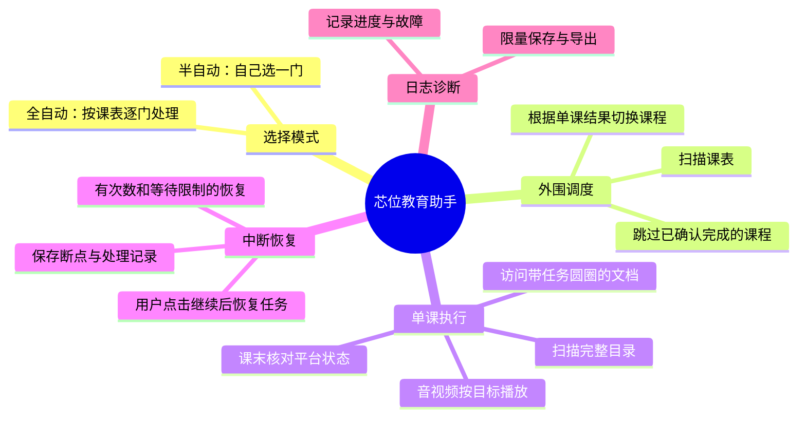

# 芯位教育助手

用于 [Beeline AI](https://www.beeline-ai.com/) 的 Chrome / Edge 扩展，支持音视频播放、任务文档访问、自动选课和断点恢复。

**当前最新版本：1.0.0 · 本仓库首版**

## 功能导图



## 安装

1. 在本仓库点击 **Code → Download ZIP**，解压到固定目录。
2. Edge 打开 `edge://extensions/`，Chrome 打开 `chrome://extensions/`，开启「开发者模式」。
3. 点击「加载已解压的扩展程序」，选择包含 `manifest.json` 的目录，再刷新芯位教育页面。

使用扩展不需要安装 Node.js。

## 怎么用

1. 登录芯位教育，进入课表，点击悬浮球展开助手。
2. 点击「获取课程列表」，等待扫描完成。
3. 在「设置」中选择播放目标，支持 **80%–100%**，默认 **100%**。
4. 根据需要选择模式：

| 模式 | 操作 | 本课结束后 |
|---|---|---|
| 半自动（默认） | 点击某门课的「开始学习」 | 等你选择下一门 |
| 全自动 | 点击「全自动开始」 | 按本轮课表继续处理 |

需要停下时点击「暂停」；刷新或休眠中断后，手动点击继续。原学习页关闭后，可从课表点击「继续运行」找回上次课程。收起面板不会暂停任务。

## 使用前注意

- 作业、考试和没有任务圆圈的参考资料不处理；可处理内容已完成的课程，不会因作业导致总进度不足100%而反复进入。
- 达到播放目标不等于平台确认完成，助手会在课末复核。恢复有次数和等待限制，登录失效、验证码或平台限制需要自己处理。
- 保持浏览器运行。可在「设置 → 后台运行」开启防自动休眠，但不能保证合盖或主动睡眠后继续运行。
- 遇到问题，可在运行日志中「导出诊断」。已有检查不代表所有课程和恢复场景都已验证。

[详细安装与使用](README-INSTALL.md) · [运行机制](docs/DUAL_MODE.md) · [日志说明](docs/LOGGING.md) · [验证范围](docs/VERIFICATION.md)

## 开发与测试

```sh
npm ci --ignore-scripts
npm run check
npm test
```

测试使用模拟页面，不能替代真实平台验证。详情见 [测试说明](tests/README.md)。

## 来源与许可证

来源于 [WuXinbo-bo/xinwei-watcher](https://github.com/WuXinbo-bo/xinwei-watcher)，保留原作者署名及 [Apache License 2.0](LICENSE)。本仓库独立维护，不代表平台或原作者官方发布。
