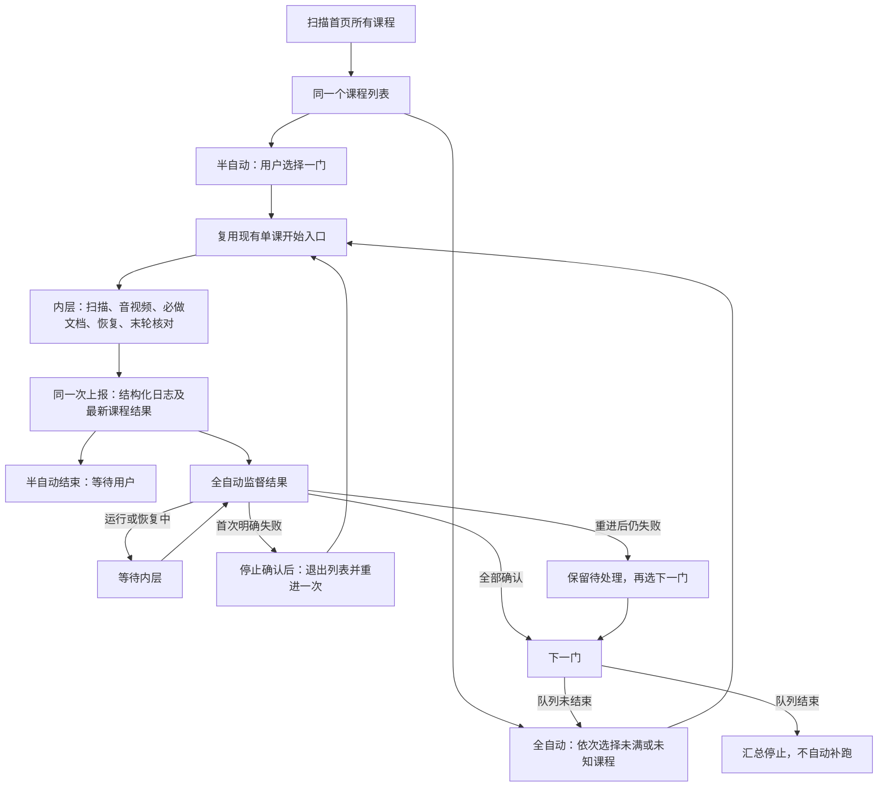

# 双模式外围调度与日志保留实施计划

日期：2026-11-15（Asia/Taipei）。状态：用户已审核通过，授权委派实施；交付后由主对话独立验收。
项目：本仓库根目录。
基线：提交8bd2f85，标签baseline-inner-1.3.9-20261115。

本计划是当前权威实施任务书。前两轮审核稿仅作讨论历史；Q5已按用户“根据你的建议走”确定为本轮不自动补跑失败课程。批准前只整理文档，不委派、不修改运行代码、不启动真实学习。

最新授权边界：只增加外围，不改变内层单课程业务逻辑。允许在既有入口/上报处增加外围所需的元数据和交接，必须保持原业务行为。若确实需要改变内层分类、完成标准、排序、播放、文档访问、目标比例或恢复行为，先停止该项改动并说明理由、最小差异和影响，由主对话向用户说明并获得确认后再实施；其余独立外围工作可继续。

## 1. 交付目标及已确认产品规则

一个课程列表、两个启动模式、一个单课内层。默认保留现有半自动使用方式，用户点击全自动开始才授权连续选课。

- 获取课程列表扫描当前网站正在上课课程的所有分页，沿用已结课排除和同名无法唯一确认时停止的现有规则。
- 初次扫描后显示全部课程的首页信息；明细缺失显示待扫描，旧内层明细注明历史，不将未知填成0。
- 半自动：用户选一门，复用原learn入口处理，结束后等待下一次用户选择，不启用外层重进或跨课。
- 全自动：按本轮课表顺序处理；当前首页可靠显示100%的课程直接略过，不进入。未知或不足100%才交给内层。100%不得来自隐藏卡片、旧日志、解析失败或简单向上取整。
- 本轮内层确认音视频及必做文档全部完成后，该课自动任务完成，不因首页整体未满而重入；作业、考试、参考文档等非处理内容不计任务。
- 单课分类、短时优先、用户80%–100%目标、播放与文档机制、课内恢复及末轮核对继续沿用。
- 内层恢复失败且已确认停止后，全自动外围为本课执行一次退出列表再重进；再次失败记录待处理并选下一门。
- 全部队列走完，显示完成、略过、失败待处理汇总；不自动补跑失败课程。
- 队列结束依据本轮每课的已保存处理结果，不以首页所有课程达到100%作为循环条件。失败待处理可以结束本轮，但不得被称为已完成学习。
- 用户暂停阻止内层动作与外围下一次派发。模式切换必须先停止当前执行，不允许两种模式并发；从全自动转半自动应撤销后续队列授权。
- 页面手动刷新、浏览器或扩展重启保留必要结果和外围已用重进次数，等待显式继续；原内层授权的恢复/课末刷新按现有机制接回。
- 全自动未运行时，更新列表不自动开始学习；队列运行期间禁止用更新列表替换其身份与索引。

## 2. 最小框架

该图为产品行为，不代表新增多套执行循环。运行与恢复时只由现有单课执行器操作资源。外围是现有后台串行处理中的少量队列状态，前台仅通过当前有效页面提交授权的一次课程命令。

## 3. 修改前必须核对与复用的入口

以下行号为基线参考，实施前按符号定位，不凭旧行号直接改。

| 文件/符号 | 当前职责 | 本次允许修改 |
|---|---|---|
| content.js:getHomeCourseCandidate / collectHomeCourses | 首页分页、当前进度、候选课程 | 复用结果，不另写首页扫描器 |
| content.js:start | 页面阻断、暂停检查及course-select发送 | 增加受控外围派发来源，复用现有前置检查 |
| background.js:selectCourse | 课程身份、代数、所有权、inspect/play/learn | 接受已授权外围的一次选课，保留身份和取消检查 |
| background.js:course-result / awaitSelection | 验证完整目录和最终结果、返回等待 | 保存结构化终态，并交由外围决定是否派发下一门 |
| background.js:serial / save / saveOwnerHandoff | 串行、先保存后操作、跨代次取消 | 复用，不另建后台调度线程或绕过暂停 |
| background.js:addLog / saveDiagnostics / diagnosticReport / export-diagnostics | 去重、有限保存、脱敏、导出 | 扩展有界历史和结果字段，不扩大job随身日志 |
| content.js:runCurrentCourseJob | 调用现有扫描/播放执行器并上报 | 仅必要的结果上报与外围交接，不改变媒体执行 |
| assistant-ui.js:learningAction及现有控制回调 | 单课按钮、状态和列表 | 增加全自动入口及整体状态，保持单课入口 |

重点冲突：旧workflow:auto已被拒绝且会触发迁移，不能恢复旧标志来复活旧全课执行器；新外围作为独立授权附着于当前单课工作流。新选择会重建部分内层记录，故外围重进次数必须独立保存。selection/running=false可能是列表结束、扫描结束、用户暂停或课末结果，不能作为统一完成信号。

## 4. 分阶段实施及交付条件

### A. 结果上报与保护基线

1. 核实实际代码、Git状态及适用指令；以8bd2f85比较，保留用户新改动和全部历史证据。
2. 列出受保护函数与调用路径：资源分类、完成判断、compareActionableItems、runSinglePassCourse、playItemToEnd、playSinglePassItem、文档访问和检查点、目标设置、课内恢复额度。
3. 复用已有内层结构化扫描/确认/恢复事件，给现有课末结果增加明确事件码和最小字段。扫描完成、学习完成、运行中、恢复中、单课失败、人工阻断、用户暂停必须可区分。
4. 内层事件与现有课程最新结果同次保存；外围用最新结果与身份进行决策，中文日志不是授权来源。媒体候选待执行数量不得混同平台未确认数量；未知文档不得当参考文档。
5. 扫描已发现全部任务完成或目录明确没有可处理任务时，应有明确结果，不强迫进入播放。不完整/空白加载失败不得当作无任务。

交付：事件字段说明、复用/冲突表、针对结果语义和旧消息的测试。内层业务规则无变化。

### B. 双模式顺序调度

1. 默认半自动；全自动开关产生新的外围运行授权，保存本轮列表顺序及当前位置。
2. 已有刚完成的列表扫描可复用；陈旧或未获取列表通过原扫描入口更新，不能反复重扫导致新索引覆盖正在执行的队列。
3. 首页100%略过，记录证据来源和时间；不足/未知经原learn入口。对本轮已由内层确认的课程不重复处理。
4. 外围保存最少必要信息：本轮ID、状态、当前课程、待发/已消费派发标记、每课结果及已用重进次数。优先复用原candidate记录，避免再复制目录。每课的完成、略过、失败待处理是本轮终态；首页进度变化、重新定位课表、刷新和旧消息不得将终态重新变为待处理。
5. 使用现有后台串行队列决定一次派发，当前有效页面经原start/course-select入口提交。校验原runId/generation/resetEpoch、列表身份和课程身份；保存后再导航。
6. 等待有效课末结果后才派发下一门。重复、迟到、旧代次结果不能多启动；运行/恢复中的内层不得被外围抢占。
7. 暂停优先于选课和导航；半自动切换撤销外围授权。磁盘恢复将外围标为待继续，不能因inner.running=false而自动开下一门。
8. 队列完成必须同时满足：初次课程范围已确认、所有队列项有本轮终态、没有活动执行器或待消费派发/交接。只要还有待处理或运行中课程，就不能报告整轮完成；只有失败待处理时可报告本轮结束并列出失败。

交付：两个模式及端到端串行调度用例，半自动保持原行为。

### C. 每课一次退出重进

1. 使用明确的内层失败终态；没有新日志、普通页面加载、内层恢复中均不触发。登录验证、用户暂停、关键存储故障等全局阻断暂停队列。
2. 保存首次故障证据及外层重进已使用标记，确认旧执行器停止，返回既有课程列表，重新唯一定位原课程，再进入并调用原开始入口。
3. 真实失败重进路径不得被“已缓存learnUrl直接重启”替代，否则没有实现退出再进入。优先复用原导航/课表定位工具，必要时最小扩展。
4. 同一外围轮次同课最多一次，页面导航、内层新代次、显式继续及诊断裁剪不得清零。暂停跨重进过程仍然有效。
5. 重进后使用正常内层有限重试；实际播放推进、资源状态推进或内层完成核对才作为恢复证据，点击开始和resource-opened不能当恢复成功。
6. 二次失败，或重进本身在有界等待内失败：保留待处理，确认已停止且仍可正常调度后继续下一门。课表失联、课程身份无法唯一确认或执行停止无法确认时暂停整体。
7. 队列结束不补跑失败课。之后用户明确单课重试是新授权，不由队列暗中发起。
8. 外围选课、返回、重进和执行器接回采用持久化的阶段等待上限，建议每阶段默认180秒，沿用现有较短的检测/重试间隔。旧导航重试、同阶段重复消息和页面刷新不得延长总预算；进入经核实的新阶段才获得该阶段预算。仅约束全自动交接，不新增整门课程播放时限，不改半自动和媒体原有恢复规则。用户暂停或浏览器休眠后先进入待确认状态，不以逝去墙钟时间自动重进或换课。
9. 结果通知遗失先读取后台已保存的同轮、同课、同尝试结果；已有有效结果则幂等推进。只有running标志、普通日志或轮询更新时间不算有效进展。仍无法确认结果或执行器存活时，在有界核对后撤销外围后续派发并显示监督失联；通过现有停止/取消机制确认停止前，不返回、不重进、不启动别课。复用现有同步/观察入口，不另建一套资源监督循环。

交付：初次失败重进成功、重进失败切下一门、重进期间暂停/重启/迟到消息等测试与证据。

### D. 有界日志、界面和交付整理

日志只扩展现有保存/导出体系，不新增服务、数据库、运行依赖、权限或每秒采样。

| 项目 | 初始上限 |
|---|---|
| 页面显示 | 80条 |
| 任务随身日志 | 300条 |
| 本地普通历史 | 1000条且不超过1MiB |
| 故障现场 | 最近10组，每组不超过20KiB |
| 轮次摘要 | 当前轮和最近2轮，受总预算约束 |
| 诊断归档总量 | 不超过2MiB，不包括执行检查点 |

- 按UTF-8序列化字节而非字符串字符数限制体积；所有单条字段继续受白名单和长度限制。
- 本地历史不随job广播到页面，只在导出/明确查看时读取。采用单一写入顺序，重复保存不重复归档。
- 普通历史沿用约10秒合并节流；新故障、重进前、课末结果优先保存。同课同阶段同尝试重复错误聚合次数及首末时间，跨尝试不可合并丢失过程。
- 优先清理旧普通日志和旧轮次，再清理最旧故障组。记录裁剪数量；重要记录也有限，不承诺无限保存。
- 新诊断归档与旧镜像兼容；保留基线重置行为，执行中不得被旧运行日志重新写回。
- 诊断失败降级提示，不新增播放停止；执行关键状态保存失败继续沿原停止规则。保留脱敏。
- 页面保留“获取/更新列表”、每门“开始学习/详情”；新增“全自动开始”和整体暂停/继续/汇总状态。明确区分课表已满略过、内层确认完成和失败待处理，不用整课百分比覆盖结果。
- 更新安装说明、变更记录、测试说明；版本元数据保持一致并与1.3.9基线可区分，按实际最小改动选定新版本号。

交付：归档、只读导出、迁移及UI测试；日志压力对比数据和可审查补丁。

## 5. 验收矩阵

| 场景 | 必须观察到的结果 |
|---|---|
| 全部分页扫描 | 所有正在上课课程只收集一次，首页数据正确，未知不归零 |
| 半自动选择一门 | 只处理选中课程，结束等待用户，外围不重进不跨课 |
| 首页100% | 全自动无课程进入/学习动作，保留略过原因 |
| 首页不足100%但媒体/必做文档全确认 | 目录核对后完成自动任务，不因作业等再次处理 |
| 音视频/文档未确认 | 由内层执行，外围不提前跳课 |
| 参考资料/作业考试 | 不计入自动任务分母；未知任务资格不被静默排除 |
| 正常两门串行 | A有本轮有效完成结果后仅启动B一次 |
| 内层运行或恢复 | 外围不点击资源、不刷新、不提前启动下一课 |
| 首次内层失败 | 保存故障，确认停止，退出列表重进同门一次 |
| 重进成功 | 有推进或完成证据，重进次数仍为1 |
| 重进后仍失败 | 当前课程列待处理，继续下一门；最终无补跑 |
| 重复或旧结果 | 不重复进入、不误标完成、不恢复暂停 |
| 暂停发生于交接/重进 | 没有迟到的启动或导航动作 |
| 手动刷新/扩展重启 | 队列与次数保留，等待明确继续，不能悄悄重启 |
| 登录验证/关键存储错误 | 队列暂停，原因可见，不能当局部失败继续操作 |
| 日志大量累积 | 所有条数与字节上限有效，UI最多80条、job最多300条 |
| 日志导出 | 包含保留的历史/现场/摘要及裁剪信息，不改变播放/任务状态 |
| 诊断保存失败 | 正常媒体流程不因纯诊断失败新增停止 |
| 作业使首页长期不足100% | 内层本轮确认完成后终态不倒退，队列最终结束 |
| 明确只有作业/考试 | 完整目录确认后记无可处理任务，不播放、不反复进入 |
| 结果通知丢失但结果已保存 | 对账后只推进一次，不重新播放 |
| 导航/接回持续失败 | 阶段总预算耗尽后明确失败或暂停，不无限延期重试 |
| 执行器失联、停止未确认 | 整体暂停并保留未知状态，不假装完成或并发开下一课 |
| 队列中途新增资源或课程 | 不自动扩大本轮；已确认发现目录变化则交内层核实，未核实不得成功；后续新轮重新扫描 |

容量/压力测试在隔离环境生成超过上限的事件，并覆盖长中文字段、跨轮次和重复故障。记录归档字节数、UI节点数、保存次数、序列化/保存耗时与相同机器的基线对比，不用一次观察宣称永不卡顿。

## 6. 委派方必须提交的材料

1. 改动清单：每个问题原逻辑位置、为何复用/为何必要新增、调用者与冲突检查。
2. 完整补丁和基线/交付SHA-256；保护函数差异清单，日志参数变化与业务变化明确区分。
3. 测试命令、完整结果和失败修复记录，不能只回复已完成。
4. 语法与差异检查：npm run check、git diff --check。
5. 针对性新增测试，随后一次完整回归：node --test --test-concurrency=4 tests/*.test.cjs。新变更或失败才追加必要复跑。
6. 已知限制、未覆盖真实场景、日志预算实测、可恢复到8bd2f85的说明。
7. 源码完成后不要自行操作用户真实浏览器、启动真实课程、恢复历史巡检或推送远程；由主对话统一验收。

实施方不得重置用户工作区、删除原始证据或引入旧全自动执行器。不得通过修改fixture放宽完成/暂停/身份检查来让测试通过。不要为了外围架构重写内层。

## 7. 委派与主对话验收流程

- 当前：用户已批准本计划及异常流程补充，开始委派实施。
- 审核通过后：将本任务书及基线交给一个实施对话，按A→B→C→D顺序完成；避免多个对话同时改同一组核心文件。持续跟进到交付，完成通知不等于验收。
- 主对话先读取完整交付和补丁，独立审查身份/代数/取消、重进预算、分类与完成语义、日志写入和上限。
- 对交付哈希核验，独立执行关键验收用例及约定回归；有问题回原实施对话修复，再检查最终版本。
- 安装/更新真实Edge中的当前项目扩展，保留已有页面，按用户授权测试两种模式；操作前保存基线，过程中导出关键诊断，观察实际播放推进和平台结果。
- 真实课程不足、均已完成或没有音频/必做文档样本时，明确哪些仅通过隔离测试；不伪造进度，不拖动播放器模拟完成，不声称所有真实分支已覆盖。
- 最终提交验收报告：改了什么、保护逻辑是否保持、测试及真实行为证据、待验证限制、使用方式。通过后另存新版本Git提交；保留原基线标签。

## 8. 完成标准

两个模式可以独立使用；全自动仅按有效内层上报串行推进；每课一次外围重进与失败换课有界；媒体和文档原行为回归不受破坏；日志可用且体积有界；主对话完成独立审查及真实Edge可用场景验证。未覆盖的真实样本单列，不作为虚假的全面通过。

## 9. 2026-11-15追加：终止条件与异常流程推演

完整推演见[全自动流程与循环风险复核](DUAL_MODE_SCENARIO_REVIEW_20261115.md)。本补充是待审核设计，并非已实现功能或真实浏览器测试结果。

平台课程进度与本轮自动任务结果分开保存。平台80%而内层确认全部受支持任务完成时，本轮课程为完成；平台0%而完整目录只有作业时，本轮为略过（无可处理任务）。首页数值保持原样，不伪造平台完成。

当前代码复核发现：background.js的course-result会核对目录任务数量和最终未确认项；isCourseTaskItem排除已识别的作业等非支持项，未知资格文档仍纳入待核对。现有expireOpening的部分导航接回路径在多次尝试后延长间隔继续等待，没有统一的最终尝试上限。因此全自动集成必须落实C.8的阶段总预算，不能只添加每课一次重进便认为已经消除无限等待。

防循环约束：本轮课程范围有限且唯一；已结算课程不重新入队；正常派发每课一次，外围额外重进每课至多一次；失败不自动补跑；交接有界；运行失联无法安全继续时转为可见暂停。这里限制的是外围派发，不替换内层既有有限恢复次数。新轮只能由明确用户操作创建，不由列表刷新或旧消息自动创建。
