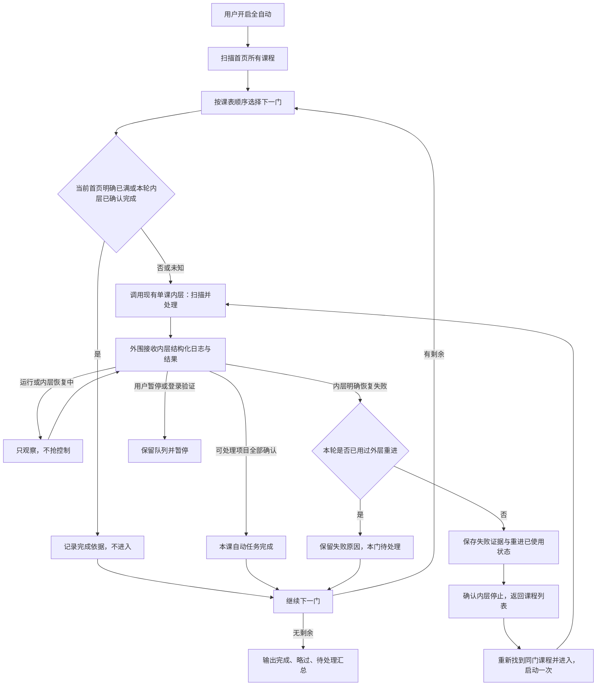

# 外围调度与日志保留：第二轮审核稿

> 后续方案已收敛为双模式，Q5已确定本轮不自动补跑。当前实施依据见 [双模式详细实施计划](DUAL_MODE_IMPLEMENTATION_PLAN_20261115.md)，本文件保留讨论历史。

日期：2026-11-15（Asia/Taipei）。仅方案，尚未修改运行代码。
基线提交：8bd2f85；标签：baseline-inner-1.3.9-20261115。
本稿取代上一轮关于首页100%仍进入扫描、失败默认停止整队的建议。

## 已确定的整体目标

首页扫描全部分页中正在上课的课程，读取首页已经显示的数据并结合可用的内层上报。当前首页明确100%的课程直接略过，不进入。首页不足100%或未知的课程，按课表顺序调用已有单课入口，由内层扫描和处理音视频、必做文档。可处理项目全部确认就结束该课自动任务；作业、考试、参考文档等不计入该目标，不要求平台整课总百分比达到100%。

首页列表无法提供的资源明细标记待扫描，进入课程后由内层补齐。历史数据注明时间，不将同名旧课程结果当作本轮身份和完成证据。已结课课程继续沿原有列表规则排除。

## 整体流程

## 分层职责

| 部分 | 负责什么 |
|---|---|
| 外围 | 全部课程列表、首页已满过滤、顺序派发、接收内层结果、每课一次退出重进、失败后切下门、总汇总 |
| 内层 | 单课完整目录、任务类型识别、短时优先、用户播放比例、文档访问与状态观察、播放器恢复、课末核对 |
| 日志与结果 | 共用内层判断；结构化事件供外围消费，中文文本供用户查看；历史诊断供排查 |

外围监督的是内层上报，不新增读取圆圈/资源DOM的第二套判断器。只读到started或播放目标达成时不认课程完成。其他非处理类型不阻碍完成，但标记未知的必做文档或真正未确认的视频也不能归为作业。

## 一次外层重进的边界

触发前提是内层明确上报恢复失败、原执行器已确认停止。内层正在恢复、短暂没有新日志、扫描等待或用户暂停均不触发。

同一门课在同一轮外围队列中最多一次外层重进。先保存外层额度消耗及失败记录，再离开课程页，返回既有课程列表入口，重新进入同一课程，并经原start/course-select授权链启动。再次核实课程身份。新内层尝试沿用现有有限恢复规则；外层额度独立于内层运行代数，导航、内层重启或日志裁剪不能恢复这次额度。

第二次内层明确失败，或退出重进动作自身失败，本课保留待处理后继续下一门。若故障属于登录验证、全站不可访问、无法确认原执行器已停止或关键任务状态不能保存，则暂停外围，不能在不安全状态下继续派发。用户暂停/重置始终撤销外围继续授权。重进成功必须用实际播放推进、可处理状态推进或课末确认等证据，不以已点击开始作为恢复成功。

课表已满的略过规则适用于常规选课；已获得本轮内层失败证据的课程不能仅因旧首页百分比覆盖为成功，按内层失败记录执行一次恢复并复核。

## 日志保留方案（建议上限，待实现及测量）

本次读取现有代码：UI80条，任务300条，近期现场12条，单一诊断镜像；普通诊断保存间隔至少10秒。任务save还会保存和广播整个job，因此不能简单大幅增加job.logs。

实测已有最终导出样本：文件203127字节；其中300条日志紧凑UTF-8序列化为122316字节。此样本仅用于容量估算，不证明任意1000条日志大小或性能相同。

| 层次 | 建议保留范围 |
|---|---|
| 页面显示 | 最近80条，继续沿现有渲染范围 |
| 运行任务随身日志 | 最近300条，不扩大页面广播载荷 |
| 本地普通历史 | 最多1000条，同时不超过1MiB，先达到哪个就裁剪 |
| 故障证据 | 最近10组，每组上限20KiB，含错误、课程资源身份、媒体状态及关键前后事件 |
| 轮次摘要 | 当前轮及最近2轮完成摘要，记录每课结果与恢复次数，受总量约束 |
| 全部诊断归档 | 总上限2MiB；不包含且不得裁剪执行所需任务检查点 |

复用现有诊断保存入口和chrome.storage.local，历史归档不随任务每次广播到页面。普通日志合并保存，沿用约10秒节流；新故障、外层重进前和课程结果等重要转折优先保存。同课程同阶段重复异常合并次数及首次/末次时间，跨恢复尝试保留区别。优先淘汰旧普通日志与旧轮次，再淘汰最旧故障组，明确记录已裁剪数量。

正常播放不新增每秒日志；关键边界附媒体快照。外围保留最新可靠内层结果于现有课程状态，与结构化日志来自同一次上报，不依赖可裁剪历史进行授权。诊断保存失败降级提示，不额外停止正常播放；关键调度状态保存失败沿原规则停止。继续过滤凭证及敏感URL参数。

导出保留的历史和关键证据，明确容量上限、裁剪及可能丢失情况；第一版不新增自动下载文件或无限历史库。

## 修改顺序与冲突检查

1. 在现有course-result及目录事件上明确外围需要的终态、计数与身份。复用原分类和完成证据，区分可处理任务完成与平台整课100%。扫描失败、恢复中、恢复耗尽、用户暂停不能混为同一状态。
2. 后台增加少量外围队列状态，沿用现有串行命令队列与有效页面发送的course-select。保留旧auto迁移隔离，不直接开启旧全自动执行器。保证同课只派发一次、过期结果不换课。
3. 增加受控一次退回列表重进；跨内层新尝试保留外层已使用额度及首次失败证据。避免新selectCourse清空内层重试记录时顺带清空外围恢复预算。
4. 扩展现有诊断归档保留策略；页面仍只收近期日志。沿用保存失败隔离及脱敏，严格测试条数、字节和裁剪边界。
5. UI增加全自动入口、整体暂停、进度汇总及故障待处理项，保留原手动单课入口。界面区分课表已满略过、内层确认完成、故障待处理。
6. 验收：现有媒体/文档回归、课程调度隔离测试、日志容量与压力测试，再进行真实Edge有限验收。

## 必须验收的场景

- 首页100%的课程无进入动作；不足100%的课程进入内层核对。
- 音视频/必做文档已全部确认但整课进度未满，不因作业等反复进课。
- 内层运行/恢复期间外围不抢控制；达到播放目标尚未确认不能提前切课。
- 首次明确失败执行一次退回列表重进；仍失败只记待处理并继续下一门，无恢复循环。
- 迟到、重复上报、页面刷新、后台重新唤醒不产生重复启动或重置外层额度。
- 暂停在课程交接/重进期间发生也必须生效；浏览器或扩展重启不默认偷偷恢复。
- 日志达条数/字节上限后仍有界；重要故障在保留范围内可导出；页面仍只渲染80条；保存失败不破坏原媒体流程。
- 真实课内音视频及文档覆盖范围据实记录；不能把合成失败恢复测试说成真实网站已经复现。

## 下一项待确认

其他课程都处理完以后，失败待处理课程是本轮到此汇总，还是自动再补跑一轮？建议第一版本轮到此汇总，用户可以单独重试，避免重进一次之后又经补跑变成重复循环。该项尚未获得用户确认。

未批准前不实施上述运行代码修改。
